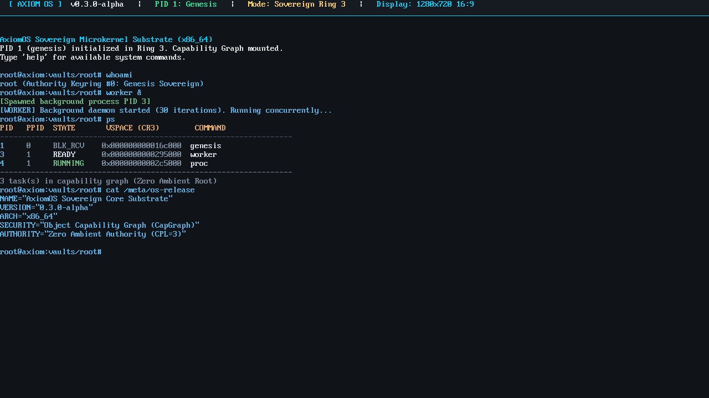
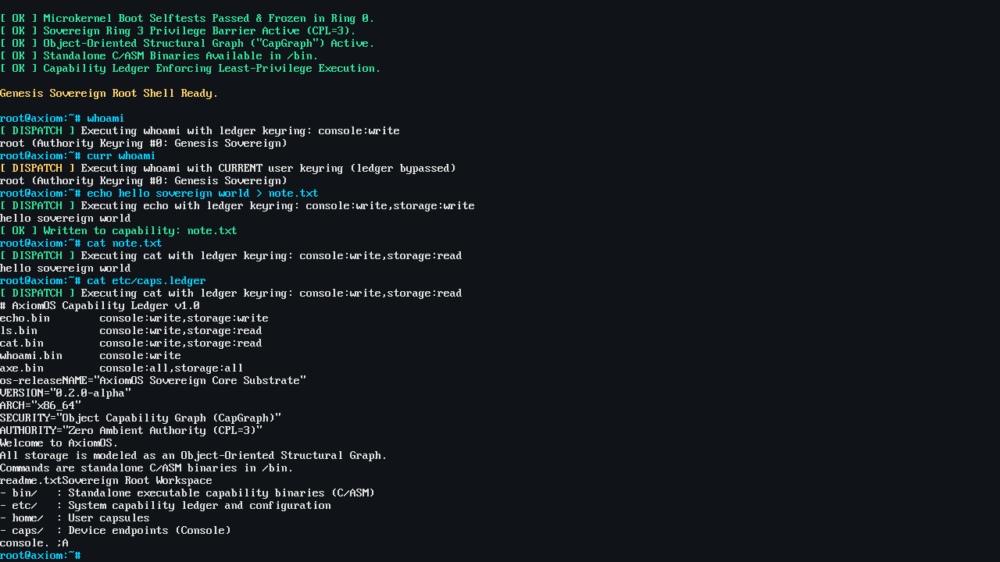
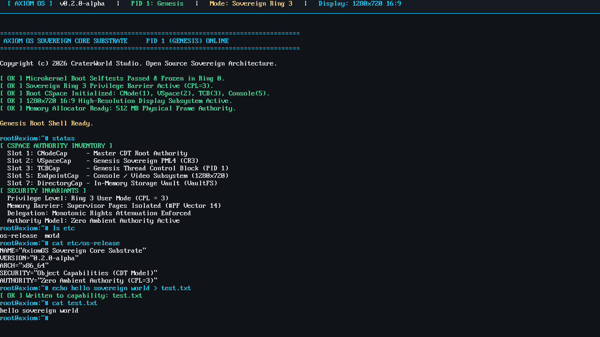
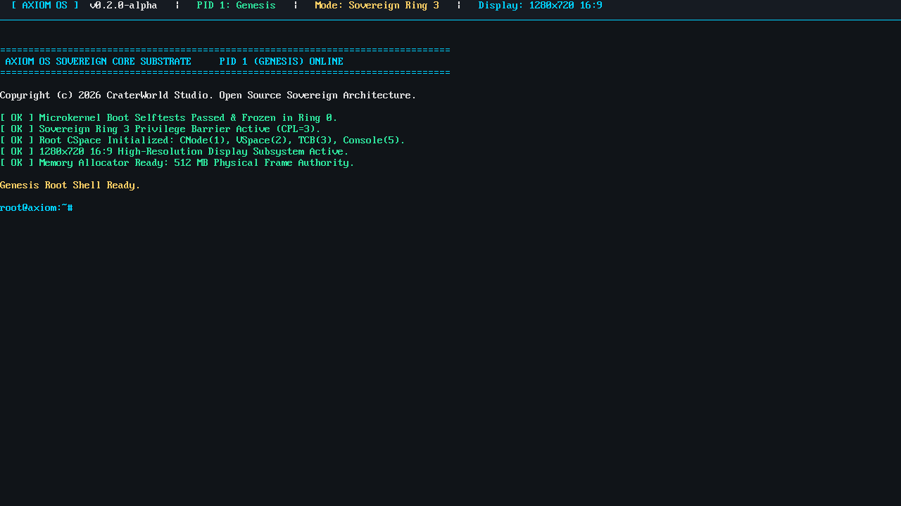
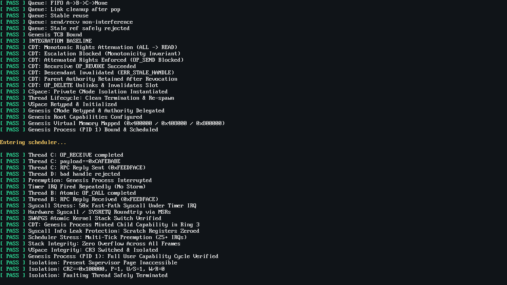

# AxiomOS

AxiomOS is a sovereign, capability-based microkernel written in Rust and x86-64 assembly. Designed under the seL4 microkernel philosophy and verifiable capability semantics, AxiomOS confines the Ring 0 kernel to minimal, mathematically verified hardware mechanisms (memory ledger, virtual address spaces, thread scheduling, and capability routing) while delegating all policy, storage, and user services to isolated Ring 3 environments.

---

## Current Architecture & Milestones

- **Phase 1: Architecture Substrate & UEFI**:
  - Sovereign 64-bit UEFI bootloader (`axiom_boot`) with GOP high-resolution graphics and memory map passing.
  - GDT with Ring 0 & Ring 3 segments, TSS with dedicated `#DF` IST stack.
  - Physical memory bitmap frame allocator.
- **Phase 2: Object Model & Capability Ledger**:
  - Retype model: `Untyped` memory authority tracking.
  - Object tables and generational capability handles `(slot, generation)`.
  - Intrusive FIFO wait queues for synchronous endpoint rendezvous IPC.
- **Phase 3: Formal VSpace & Virtual Memory Isolation**:
  - Sovereign PML4 construction with supervisor-only huge page protection (`0 - 2 MiB`, `U/S = 0`).
  - Dynamic `CR3` address space switching per thread.
  - Page Fault (`#PF`, Vector 14) trap handling with fault verification and clean thread termination.
- **Phase 4: Local APIC Timer, Preemption & Stress Hardening**:
  - Local APIC (LAPIC) driver with MSR `0x1B` validation and legacy 8259 PIC masking.
  - Hardware PIT Channel 2 calibration (10 ms countdown).
  - Ring 3 preemption with bounded Ring 0 deferral ($< 5\,\mu\text{s}$).
  - Dual-frame context switching (`FrameKind::Cooperative` vs `FrameKind::Interrupt`).
  - Dynamic `TSS.RSP0` retargeting per thread.
  - 16-byte System V AMD64 ABI stack alignment and user segment selector restoration.
  - Stress testing: 50x rapid syscalls under active timer IRQ, 25+ preemption time-slices, dynamic thread lifecycle/reuse, and stack canary verification.
- **Phase 5: Hardware Fast-Path Syscall Gateway, CDT & Atomic RPC (Microkernel Freeze)**:
  - Hardware fast-path system calls via x86 MSRs (`IA32_EFER`, `STAR`, `LSTAR`, `SFMASK`, `KERNEL_GS_BASE`).
  - Atomic kernel stack isolation via `swapgs` using per-CPU `CpuLocal` state.
  - Full Capability Derivation Tree (CDT) with rights monotonicity enforcement ($R_{\text{child}} \subseteq R_{\text{parent}}$) and recursive transitive revocation (`OP_MINT`, `OP_REVOKE`, `OP_DELETE`).
  - Synchronous atomic RPC rendezvous primitive (`OP_CALL`) with direct timeslice handover (`enqueue_front`).
  - Security hardening: Spectre v1 speculation barrier (`lfence`), SYSRET non-canonical address validation (CVE-2012-0217 mitigation), user data segment reload (`0x1B`), and complete scratch register sanitization (`RDI`, `RSI`, `RDX`, `R8`, `R9`, `R10`).
  - Formal microkernel boundary freeze: Ring 0 code locked; all subsequent OS services (shell, memory allocators, compilers, login) run in Ring 3.
- **Phase 6: The Genesis Process (PID 1) & `libaxiom` Capability Runtime**:
  - Legacy `axiom_core` decoupled and archived to `archive/axiom_core`.
  - Created `libaxiom`: pure `#![no_std]` user-space capability runtime crate providing strongly typed capability wrappers (`EndpointCap`, `CNodeCap`, `UntypedCap`), hardware `syscall` gateway, synchronous IPC (`call`, `send`, `recv`), lock-free user `BumpAllocator`, and capability-backed console printing.
  - Created `axiom_genesis`: Ring 3 root user task independently compiled and linked at virtual address `0x400000`.
  - Dynamic multi-page binary loader in `main_prod.rs` mapping arbitrary user binary sizes.
  - Root CSpace mapping: `ROOT_SLOT_CNODE=1`, `VSPACE=2`, `TCB=3`, `CONSOLE=5`.
  - Verified full Ring 3 user capability cycle: 54/54 automated boot selftests passing in emerald green.
- **Phase 7B: Sovereign Capability Filesystem ("VaultFS" / "CapFS"), PS/2 Keyboard Driver & Interactive Shell**:
  - Non-blocking PS/2 keyboard hardware input via microkernel `OP_CONSOLE_GETCHAR = 10` on root Console endpoint (`slot 5`).
  - Full PC/AT Scancode Set 1 make/break decoder with shift combinations, symbols, Enter, and Backspace rubout on GOP canvas.
  - Zero-ambient-authority in-memory capability filesystem (`VaultFS`) with isolated namespaces (`ROOT_SLOT_STORAGE = 7`).
  - Authority Keyrings replacing traditional UNIX UIDs with cryptographically bounded capability sets.
  - Interactive Genesis Root Shell commands: `status`, `ls [dir]`, `cat <file>`, `echo <text> [> file]`, `help`, `clear`, `reboot`.
- **Phase 7C: Object-Oriented Structural Graph ("CapGraph"), C/ASM Userland Toolchain & Capability Ledger**:
  - Replaced hierarchical tree filesystem with an **Object-Oriented Structural Graph ("CapGraph")**: directories are Capability Maps (key-value stores mapping strings to `CapToken`s), forming a DAG/cyclic network with zero ambient root.
  - Native **C & x86_64 Assembly Userland Toolchain** (`userland/`) with custom linker script (`linker.ld`), startup crt0 stub (`crt0.s`), and runtime (`libaxiom.c`).
  - Standalone command binaries migrated from Rust to clean C and x86_64 Assembly: `echo.c`, `whoami.asm`, `ls.c`, `cat.c`, and `axe.c`.
  - **`axe` Code & Text Editor**: Fullscreen interactive editor with obsidian canvas, line numbering, status bar, and shortcut handlers (`Ctrl+S`, `Ctrl+Q`).
  - **Shell Capability Ledger** (`/etc/caps.ledger`): Strict per-binary capability attenuation enforcing least privilege.
  - **Ledger Bypass (`curr <cmd>`)**: Allows running executables directly with caller's active authority keyring.
  - Append-only non-root ledger update protocol enforcing capability monotonicity ($R_{\text{pkg}} \subseteq R_{\text{caller}}$).
  - Virtual memory hardening: expanded BSS to 64 pages (256 KiB) and mapped 16 physical execution frames (`0x500000`..`0x510000`).

- **Phase 9: Ring 3 Multi-Process Lifecycle & Task Spawner**:
  - Implemented hardware capability syscalls `OP_TASK_SPAWN(12)`, `OP_TASK_WAIT(13)`, `OP_TASK_EXIT(14)`.
  - Preemptive round-robin scheduler with Ring 3 context switching (`switch_to_interrupt_frame`).
- **Phase 9.5: Process Management Suite & Background Execution**:
  - Hardware process inspection and management syscalls: `OP_TASK_LIST(15)` and `OP_TASK_KILL(16)`.
  - Comprehensive userland process suite: `proc list`, `proc kill <pid>`, `proc info <pid>`, `proc clean`.
  - Background workload daemon: `worker` with configurable heartbeats.
  - Genesis shell background operator `&` (`worker &`) and shell aliases (`ps`, `kill`).
- **Phase 9.6: Automatic Zombie Reaping & Memory Hardening**:
  - Supervisor huge page mapping (`PD[0]` & `PD[1]`) across all child VSpaces and 32 KiB kernel stacks.
  - Shell-level auto-reaper and microkernel-level zombie object destruction.
- **Phase 9.7: Substrate Domain Separation & Boot Modularity (v0.3.0)**:
  - Repository partitioned into `kernel/` (Microkernel & Bootloaders) and `os/` (Genesis, libaxiom, userland apps).
  - Boot Modularity: Microkernel decoupled from userspace binary; UEFI bootloader loads `genesis.bin` from ESP into memory and passes it via `BootInfo`.
  - 100% OS-agnostic microkernel: third-party OS personalities can boot on Axiom Microkernel simply by supplying `genesis.bin`.

---

## Repository Architecture

```text
AxiomOS-supreme/
├── kernel/                  # The Bare-Metal Microkernel Substrate (Ring 0 / Boot)
│   ├── boot/                # Bootloaders (axiom_boot UEFI, bios MBR/stage2)
│   └── microkernel/         # axiom_kernel (Capability microkernel, TCB, paging, IPC)
│
├── os/                      # AxiomOS Sovereign Userspace (Ring 3)
│   ├── genesis/             # axiom_genesis (Ring 3 init process & capability shell)
│   ├── libaxiom/            # Rust capability library & CapGraph structural filesystem
│   └── userland/            # C/ASM standalone command binaries & C runtime
│
├── tools/                   # Disk image forging tools (make_gpt_disk.py)
├── docs/                    # Architecture guides, ADRs, and Boot Modularity spec
└── build.sh                 # Unified build & launch orchestrator
```

---

## Production Verification & Sovereign Canvas

### Phase 9.7: Substrate Separation & Boot Modularity Verified (v0.3.0)


### Phase 7C: Object-Oriented Structural Graph ("CapGraph"), C/ASM Binaries & Capability Ledger Verified


### Phase 7B: Interactive Genesis Root Shell & Capability Filesystem Verified


### Phase 7A: Sovereign Screen Takeover & Live Genesis Root Shell


### Phase 6: Genesis Process (PID 1) Verified (54/54 Boot Selftests Passed)


---

## Building and Running

### Prerequisites
- `rustup` with `nightly` toolchain and targets:
  - `x86_64-unknown-none`
  - `x86_64-unknown-uefi`
- `gcc` and `nasm` (for userland C and x86_64 assembly command binaries)
- `qemu-system-x86_64`
- `ovmf` / `edk2-ovmf`
- `mtools` (`mcopy`, `mmd`)
- `dosfstools` (`mkfs.vfat`)

### Build & Run Commands
```bash
# Full Build & Run (UEFI mode with GOP graphics display)
./build.sh

# Production Mode (Comprehensive selftests & process preemption)
./build.sh -prod

# Modular Builds:
./build.sh -kernel-only -no-run    # Compile only UEFI bootloader & microkernel
./build.sh -os-only                # Compile only C userland apps & Genesis

# Legacy BIOS Mode (MBR Stage 1 & Stage 2 fallback)
./build.sh -bios
```

---

## Documentation
- [Architecture Roadmap](docs/02-ARCHITECTURE-ROADMAP.md)
- [Boot Modularity & Custom OS Personality Guide](docs/08-BOOT-MODULARITY.md)
- [Sovereign Capability Filesystem ("VaultFS" / "CapFS") Architecture](docs/07-CAPABILITY-FILESYSTEM.md)
- [ADR Index](docs/05-ADRs/)
- [Capability Lifecycle Model](docs/06-CAPABILITY-LIFECYCLE.md)

