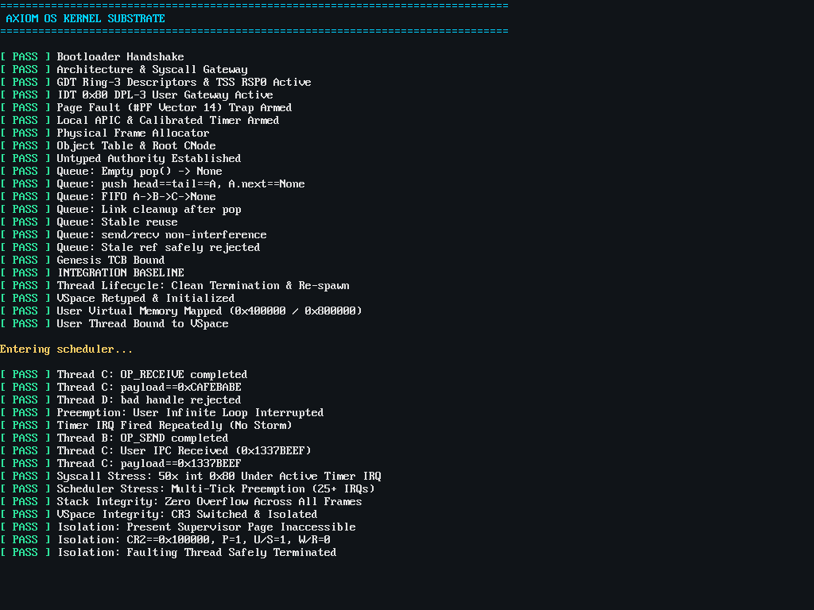

# AxiomOS

AxiomOS is a sovereign, capability-based microkernel written in Rust and x86-64 assembly. Designed under the seL4 microkernel philosophy and verifiable capability semantics, AxiomOS confines the Ring 0 kernel to minimal, mathematically verified hardware mechanisms (memory ledger, virtual address spaces, thread scheduling, and capability routing) while delegating all policy, storage, and user services to isolated Ring 3 environments.

---

## Current Architecture & Milestones

- **Phase 1: Architecture Substrate & UEFI**:
  - Sovereign 64-bit UEFI bootloader (`axiom_boot`) with GOP high-resolution graphics and memory map passing.
  - GDT with Ring 0 & Ring 3 segments, TSS with dedicated `#DF` IST stack.
  - Physical memory bitmap frame allocator.
- **Phase 2: Object Model & Capability Ledger**:
  - Retype model: `Untyped` memory authority tracking.
  - Object tables and generational capability handles `(slot, generation)`.
  - Intrusive FIFO wait queues for synchronous endpoint rendezvous IPC.
- **Phase 3: Formal VSpace & Virtual Memory Isolation**:
  - Sovereign PML4 construction with supervisor-only huge page protection (`0 - 2 MiB`, `U/S = 0`).
  - Dynamic `CR3` address space switching per thread.
  - Page Fault (`#PF`, Vector 14) trap handling with fault verification and clean thread termination.
- **Phase 4: Local APIC Timer, Preemption & Stress Hardening**:
  - Local APIC (LAPIC) driver with MSR `0x1B` validation and legacy 8259 PIC masking.
  - Hardware PIT Channel 2 calibration (10 ms countdown).
  - Ring 3 preemption with bounded Ring 0 deferral ($< 5\,\mu\text{s}$).
  - Dual-frame context switching (`FrameKind::Cooperative` vs `FrameKind::Interrupt`).
  - Dynamic `TSS.RSP0` retargeting per thread.
  - 16-byte System V AMD64 ABI stack alignment and user segment selector restoration.
  - Stress testing: 50x rapid syscalls under active timer IRQ, 25+ preemption time-slices, dynamic thread lifecycle/reuse, and stack canary verification.

---

## Production Verification



---

## Building and Running

### Prerequisites
- `rustup` with `nightly` toolchain and targets:
  - `x86_64-unknown-none`
  - `x86_64-unknown-uefi`
- `qemu-system-x86_64`
- `ovmf` / `edk2-ovmf`
- `mtools` (`mcopy`, `mmd`)
- `dosfstools` (`mkfs.vfat`)

### Build & Run Commands
```bash
# Development Mode (High-Res GOP terminal, live threads)
./build.sh

# Production Mode (Comprehensive self-test suite & preemption stress)
./build.sh -prod

# Legacy BIOS Mode (MBR Stage 1 & Stage 2 fallback)
./build.sh -bios
```

---

## Documentation
- [Architecture Roadmap](docs/02-ARCHITECTURE-ROADMAP.md)
- [ADR Index](docs/05-ADRs/)
  - [ADR-0007: Preemption Architecture, LAPIC Timer, and Bounded Ring-0 Deferral](docs/05-ADRs/ADR-007.md)
- [Capability Lifecycle Model](docs/06-CAPABILITY-LIFECYCLE.md)
