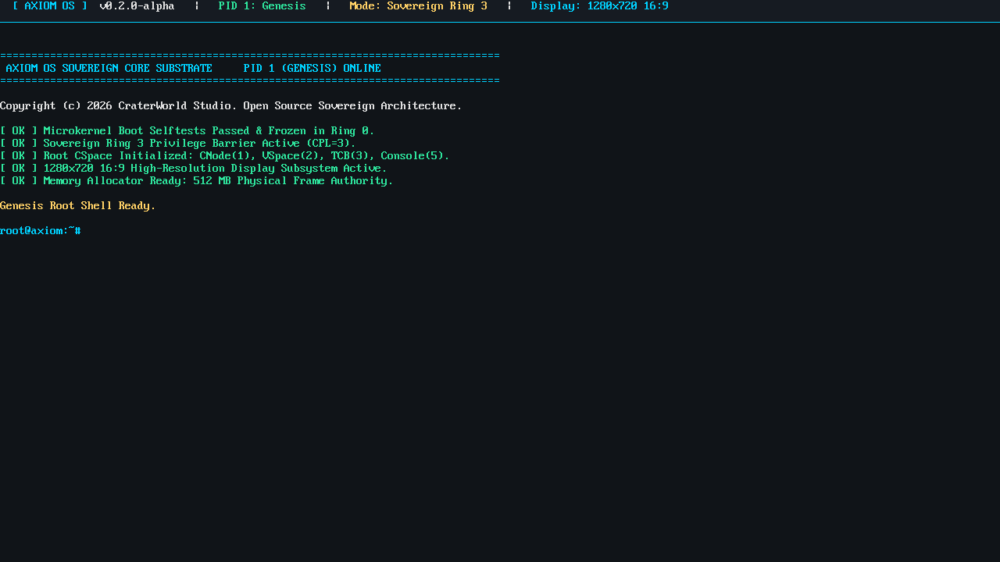
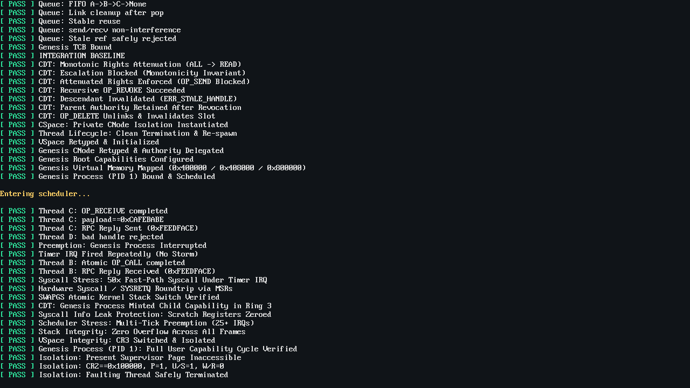

# AxiomOS

AxiomOS is a sovereign, capability-based microkernel written in Rust and x86-64 assembly. Designed under the seL4 microkernel philosophy and verifiable capability semantics, AxiomOS confines the Ring 0 kernel to minimal, mathematically verified hardware mechanisms (memory ledger, virtual address spaces, thread scheduling, and capability routing) while delegating all policy, storage, and user services to isolated Ring 3 environments.

---

## Current Architecture & Milestones

- **Phase 1: Architecture Substrate & UEFI**:
  - Sovereign 64-bit UEFI bootloader (`axiom_boot`) with GOP high-resolution graphics and memory map passing.
  - GDT with Ring 0 & Ring 3 segments, TSS with dedicated `#DF` IST stack.
  - Physical memory bitmap frame allocator.
- **Phase 2: Object Model & Capability Ledger**:
  - Retype model: `Untyped` memory authority tracking.
  - Object tables and generational capability handles `(slot, generation)`.
  - Intrusive FIFO wait queues for synchronous endpoint rendezvous IPC.
- **Phase 3: Formal VSpace & Virtual Memory Isolation**:
  - Sovereign PML4 construction with supervisor-only huge page protection (`0 - 2 MiB`, `U/S = 0`).
  - Dynamic `CR3` address space switching per thread.
  - Page Fault (`#PF`, Vector 14) trap handling with fault verification and clean thread termination.
- **Phase 4: Local APIC Timer, Preemption & Stress Hardening**:
  - Local APIC (LAPIC) driver with MSR `0x1B` validation and legacy 8259 PIC masking.
  - Hardware PIT Channel 2 calibration (10 ms countdown).
  - Ring 3 preemption with bounded Ring 0 deferral ($< 5\,\mu\text{s}$).
  - Dual-frame context switching (`FrameKind::Cooperative` vs `FrameKind::Interrupt`).
  - Dynamic `TSS.RSP0` retargeting per thread.
  - 16-byte System V AMD64 ABI stack alignment and user segment selector restoration.
  - Stress testing: 50x rapid syscalls under active timer IRQ, 25+ preemption time-slices, dynamic thread lifecycle/reuse, and stack canary verification.
- **Phase 5: Hardware Fast-Path Syscall Gateway, CDT & Atomic RPC (Microkernel Freeze)**:
  - Hardware fast-path system calls via x86 MSRs (`IA32_EFER`, `STAR`, `LSTAR`, `SFMASK`, `KERNEL_GS_BASE`).
  - Atomic kernel stack isolation via `swapgs` using per-CPU `CpuLocal` state.
  - Full Capability Derivation Tree (CDT) with rights monotonicity enforcement ($R_{\text{child}} \subseteq R_{\text{parent}}$) and recursive transitive revocation (`OP_MINT`, `OP_REVOKE`, `OP_DELETE`).
  - Synchronous atomic RPC rendezvous primitive (`OP_CALL`) with direct timeslice handover (`enqueue_front`).
  - Security hardening: Spectre v1 speculation barrier (`lfence`), SYSRET non-canonical address validation (CVE-2012-0217 mitigation), user data segment reload (`0x1B`), and complete scratch register sanitization (`RDI`, `RSI`, `RDX`, `R8`, `R9`, `R10`).
  - Formal microkernel boundary freeze: Ring 0 code locked; all subsequent OS services (shell, memory allocators, compilers, login) run in Ring 3.
- **Phase 6: The Genesis Process (PID 1) & `libaxiom` Capability Runtime**:
  - Legacy `axiom_core` decoupled and archived to `archive/axiom_core`.
  - Created `libaxiom`: pure `#![no_std]` user-space capability runtime crate providing strongly typed capability wrappers (`EndpointCap`, `CNodeCap`, `UntypedCap`), hardware `syscall` gateway, synchronous IPC (`call`, `send`, `recv`), lock-free user `BumpAllocator`, and capability-backed console printing.
  - Created `axiom_genesis`: Ring 3 root user task independently compiled and linked at virtual address `0x400000`.
  - Dynamic multi-page binary loader in `main_prod.rs` mapping arbitrary user binary sizes.
  - Root CSpace mapping: `ROOT_SLOT_CNODE=1`, `VSPACE=2`, `TCB=3`, `CONSOLE=5`.
  - Verified full Ring 3 user capability cycle: 54/54 automated boot selftests passing in emerald green.
- **Phase 7A: Sovereign Screen Takeover & High-Resolution Console Canvas**:
  - Genesis Process (PID 1) invokes root Console endpoint (`ROOT_SLOT_CONSOLE = 5`) via `OP_CONSOLE_BANNER = 8`.
  - Clears boot diagnostic selftest screen and renders a 28-pixel high obsidian status bar (`#161B22`) with an electric cyan accent line (`#00D2FF`) on 1280x720 16:9 widescreen GOP canvas.
  - Formatted user-space `print!` and `println!` macros via `libaxiom::console::ConsoleWriter`.
  - AxiomOS welcome banner rendered and live sovereign `root@axiom:~#` prompt loop entered in Ring 3 ($CPL=3$).

---

## Production Verification & Sovereign Canvas

### Phase 7A: Sovereign Screen Takeover & Live Genesis Root Shell


### Phase 6: Genesis Process (PID 1) Verified (54/54 Boot Selftests Passed)


---

## Building and Running

### Prerequisites
- `rustup` with `nightly` toolchain and targets:
  - `x86_64-unknown-none`
  - `x86_64-unknown-uefi`
- `qemu-system-x86_64`
- `ovmf` / `edk2-ovmf`
- `mtools` (`mcopy`, `mmd`)
- `dosfstools` (`mkfs.vfat`)

### Build & Run Commands
```bash
# Development Mode (High-Res GOP terminal, live threads)
./build.sh

# Production Mode (Comprehensive 54-test suite, preemption stress & screen takeover)
./build.sh -prod

# Legacy BIOS Mode (MBR Stage 1 & Stage 2 fallback)
./build.sh -bios
```

---

## Documentation
- [Architecture Roadmap](docs/02-ARCHITECTURE-ROADMAP.md)
- [Sovereign Capability Filesystem ("VaultFS" / "CapFS") Architecture](docs/07-CAPABILITY-FILESYSTEM.md)
- [ADR Index](docs/05-ADRs/)
  - [ADR-0007: Preemption Architecture, LAPIC Timer, and Bounded Ring-0 Deferral](docs/05-ADRs/ADR-007.md)
  - [ADR-0008: Hardware Fast-Path Syscall Gateway, Capability Derivation Tree (CDT), Atomic RPC, and Kernel Boundary Freeze](docs/05-ADRs/ADR-008.md)
  - [ADR-0009: The Genesis Process (PID 1) & User-Space Capability Runtime (libaxiom)](docs/05-ADRs/ADR-009.md)
  - [ADR-0010: Sovereign Screen Takeover, Object-Capability Console Subsystem, and Text-Based GUI Canvas](docs/05-ADRs/ADR-010.md)
  - [ADR-0011: Sovereign Capability Filesystem ("VaultFS"), Authority Keyrings, and Interactive Shell Architecture](docs/05-ADRs/ADR-011.md)
- [Capability Lifecycle Model](docs/06-CAPABILITY-LIFECYCLE.md)
